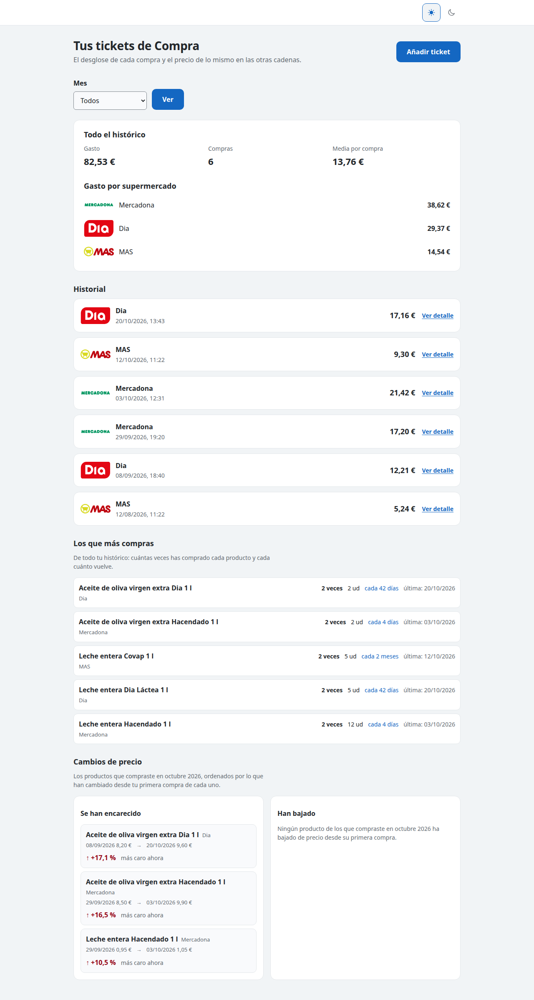
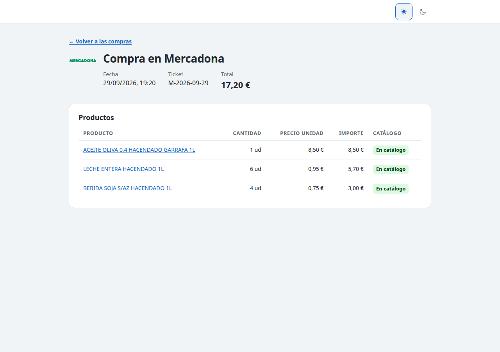
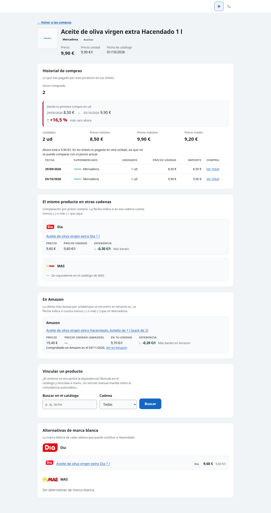
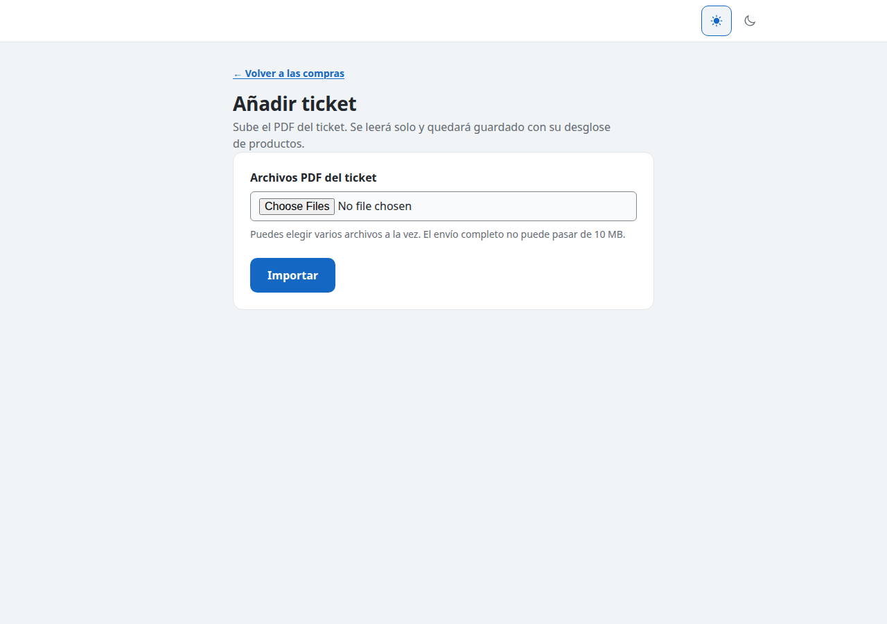
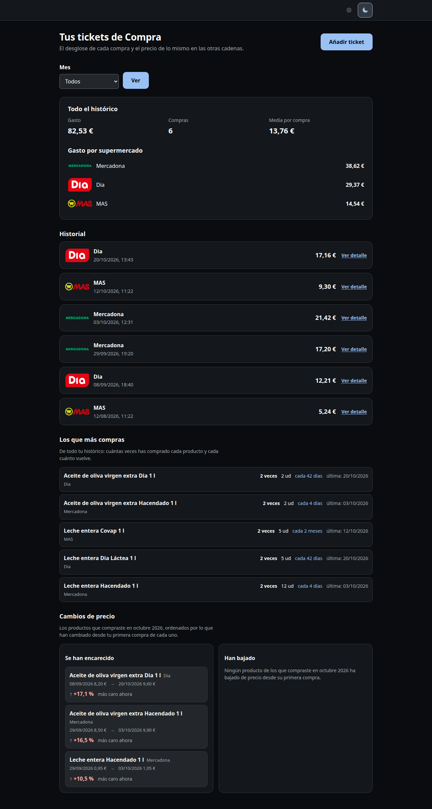

# Tus tickets de Compra — analizador de tickets y comparador de precios

Una aplicación para una sola persona: importa tus tickets de supermercado, te dice en qué se te va
el dinero y a qué precio está hoy **lo mismo** en otra cadena.

No es un rastreador de precios genérico: la unidad de trabajo es *tu* ticket. Cada línea de cada
compra se empareja con el catálogo actual de la tienda y la comparación se hace por precio unitario
(€/kg, €/l), que es lo único comparable entre un brick de un litro y una garrafa de cinco.



## Objetivo

Dos capacidades sobre la misma base de datos SQLite:

1. **Saber qué compras y cuánto te cuesta.** Gastos por cadena, por mes y por producto, evolución
   del precio de lo que repites y aviso de lo que se ha encarecido desde tu primera compra.
2. **Comparar lo mismo entre cadenas.** Para cada producto de tu ticket, el precio equivalente en
   Mercadona, Día y Supermercados MAS, las alternativas de marca blanca y la oferta más barata en
   Amazon cuando la hay.

## Índice

- [Capturas](#capturas)
- [Cómo funciona](#cómo-funciona)
- [Instalación](#instalación)
- [Manual de uso](#manual-de-uso)
- [Comandos](#comandos)
- [Dónde viven tus datos](#dónde-viven-tus-datos)
- [Base de datos de demostración y capturas](#base-de-datos-de-demostración-y-capturas)
- [Pruebas](#pruebas)
- [Estructura del repositorio](#estructura-del-repositorio)
- [Limitaciones conocidas](#limitaciones-conocidas)
- [Origen del código](#origen-del-código)

## Capturas

| Compra | Ficha de producto |
|---|---|
|  |  |

| Añadir ticket | Tema oscuro |
|---|---|
|  |  |

Las capturas se generan con `scripts/capturas.py` sobre la base de demostración: no contienen
ninguna compra real.

## Cómo funciona

```
        tickets de la cuenta (API/PDF)      PDF sueltos que descargas a mano
                    │                                   │
                    ▼                                   ▼
   supermarket/  ── connectores ──►  tickets/parsing.py (texto o OCR)  ──►  tickets/store.py
   Mercadona, Día, MAS, Amazon                                                 │
                    ▲                                                          ▼
        catálogos de precios  ─────────────────────────────────────►   SQLite (una sola)
                    │                                                          │
                    └──────────────►  tickets/matching.py  ◄───────────  reports/report.py
                                      (empareja ticket ↔ catálogo)            web/app.py
```

- **Catálogos** (`precios`): Mercadona por su API pública; Día y MAS con las APIs de su tienda
  online. Cada producto guarda su precio y su €/unidad, y cada pasada añade una observación, así
  que la serie de precios se construye sola.
- **Tickets** (`tickets`): de la cuenta de Día llegan como JSON exacto —sin OCR, con
  `variable_weight` marcando las líneas por peso—; de la cuenta de MAS, como el mismo PDF que
  descargarías a mano. Los PDF sueltos se leen con `pypdf` y, si no tienen capa de texto, con
  Tesseract.
- **Emparejamiento** (`tickets/matching.py`): normaliza, compara por nombre y por formato, y
  **nunca inventa**. Si la confianza es baja la línea queda sin emparejar y se marca; un alias
  confirmado a mano se guarda y no se vuelve a preguntar.
- **Sesiones**: Día y MAS necesitan sesión. No hay que pegar cookies: `supermarket/firefox.py` lee
  las de tu perfil de Firefox (que las guarda sin cifrar), copiando su base de datos a un
  directorio temporal que se borra al terminar, y sólo devuelve las de la tienda que toca. Día está detrás de
  Akamai y sólo acepta un Chromium con ventana real, así que en un servidor se lanza con
  `xvfb-run -a`.

## Instalación

Requisitos: Python 3.11 o superior, Firefox con sesión iniciada en las tiendas que uses, y
`tesseract-ocr` + `tesseract-ocr-spa` sólo si vas a leer tickets escaneados.

```bash
git clone https://github.com/yerbajo/supermarket-ticket-analyzer.git
cd supermarket-ticket-analyzer
python3 -m venv .venv
source .venv/bin/activate
pip install -r requirements.txt
playwright install chromium        # Día, sus fotos y la búsqueda en Amazon abren un navegador real
cp env.example .env                # opcional: DB_PATH, TICKETS_INBOX
mkdir -p samples/inbox             # deja aquí los PDF que descargues a mano
```

`.env` es opcional: sin él la base de datos es `tickets.db` en el directorio del proyecto y los PDF
se buscan en `samples/inbox`.

## Manual de uso

### 1. Trae tu catálogo de precios

```bash
python3 tickets_cli.py precios --cadena todas
```

Descarga el catálogo de las tres cadenas y lo guarda en la base de datos. Tarda unos minutos: la
herramienta espera medio segundo entre peticiones por educación (`--pausa 0` para no esperar).
En una máquina sin pantalla, Día necesita `xvfb-run -a` delante.

Comprueba qué tienes sin escribir nada:

```bash
python3 tickets_cli.py estado
```

### 2. Comprueba las sesiones antes de descargar tickets

```bash
python3 tickets_cli.py sesiones            # mira si hay cookies de las tiendas en Firefox
python3 tickets_cli.py sesiones --navegador # además lo comprueba de verdad contra la tienda
```

Si una sesión ha caducado, lo dice por su nombre y no sigue. La solución es abrir Firefox, iniciar
sesión en esa tienda y repetir. Con otro perfil: `FIREFOX_PROFILE=/ruta/del/perfil`.

### 3. Trae los tickets de tus cuentas

```bash
python3 tickets_cli.py tickets --descargar-dia --descargar-mas --imagenes --solo-comprados
```

Baja los tickets de la cuenta de Día (JSON exacto) y de la de MAS (los mismos PDF que te descargarías
a mano), los importa, los empareja con el catálogo y trae las fotos que falten.

### 4. O importa un PDF suelto

Deja el PDF en `samples/inbox/` y lanza lo mismo sin los `--descargar-*`:

```bash
python3 tickets_cli.py tickets
```

O súbelo desde la web, en **Añadir ticket** (hasta 10 MB por fichero): valida que sea un PDF, lo
parsea y te dice qué ha importado y qué líneas ha dejado sin emparejar.

### 5. Abre la aplicación

```bash
DB_PATH=report/full.db python3 -m uvicorn web.app:app --host 127.0.0.1 --port 8130
```

Y abre <http://127.0.0.1:8130>. No hay autenticación: es una aplicación para una persona, pensada
para escucharse en `127.0.0.1` o en tu red local. No la expongas a internet.

- **Portada**: el mes en curso, con gasto, número de compras y media; debajo, el historial, lo que
  más compras (con cada cuánto vuelve) y los cambios de precio de lo que compraste ese mes. El
  selector **Mes** cambia el resumen y el historial; las dos listas de abajo miran a todo el
  histórico a propósito. **Todo el histórico** enseña todo junto.
- **Detalle de una compra**: cada línea con cantidad, precio unitario, importe y si está en
  catálogo. Una línea por peso se enseña con su €/kg; si el ticket no trae el dato, se enseña un
  guion: nunca un cero ni una suposición.
- **Ficha de producto**: lo que has pagado por ese producto (mínimo, máximo, media y evolución), el
  mismo producto en las otras cadenas comparado por €/unidad, la oferta de Amazon si la hay, y las
  alternativas de marca blanca.
- **Vincular un producto**: si el emparejamiento automático no encontró la equivalencia, busca en
  el catálogo y vincúlala a mano. Un vínculo manual manda sobre la coincidencia automática y se
  puede deshacer.
- **Tema**: claro, oscuro o el del sistema, recordado en el navegador y aplicado antes del primer
  pintado.

### 6. Genera el informe estático

```bash
python3 tickets_cli.py informe --salida report/informe.html
```

Un HTML autocontenido, sin recursos externos, con el gasto por cadena, por mes y por producto y la
evolución de precios. Sirve para abrirlo desde el móvil o para guardarlo como histórico.

### 7. Busca ofertas en Amazon

```bash
python3 tickets_cli.py amazon --limite 20        # productos donde comprar allí puede salir a cuenta
python3 tickets_cli.py amazon --buscar "aceite de oliva 1l"   # búsqueda suelta, no guarda nada
```

### 8. Déjalo programado (opcional)

Una ejecución diaria que descarga catálogos, trae tickets y regenera el informe; la línea de
crontab y qué hacer cuando falla están en [`docs/cron.md`](docs/cron.md).

### 9. Despliegue con Docker (opcional)

El `Dockerfile` construye una imagen con Chromium, Xvfb y Tesseract; el servicio escucha en el
puerto 8130 y se sirve detrás de un proxy inverso. El script `scripts/sincronizar.sh` hace el ciclo
completo en la máquina con Firefox —trae tickets, copia la base al host y reconstruye el
contenedor—; el host se configura con `COMPRAS_HOST` o con `scripts/host.local` (ignorado por git),
y `--sin-host` se queda en local.

## Comandos

| Comando | Qué hace |
|---|---|
| `precios` | Descarga los catálogos (`--cadena`, `--pausa`, `--max-peticiones`, `--categorias`) |
| `tickets` | Importa PDF de `--inbox` y empareja (`--descargar-dia`, `--descargar-mas`, `--imagenes`, `--solo-comprados`) |
| `informe` | Genera el informe HTML estático (`--salida`) |
| `estado` | Resumen de lo que hay en la base de datos, sin escribir nada |
| `sesiones` | ¿Siguen valiendo las sesiones de las tiendas? (`--navegador`) |
| `imagenes` | Descarga las fotos de producto (`--cadena`, `--solo-comprados`, `--limite`, `--rehacer`) |
| `amazon` | Busca ofertas en Amazon y las guarda (`--limite`, `--producto`, `--buscar`) |
| `actualizar` | Entrada de cron: catálogos, tickets e informe, en ese orden |

Todos aceptan `--db RUTA` (por defecto `$DB_PATH` o `tickets.db`). `python3 tickets_cli.py --help`
y `python3 tickets_cli.py <comando> --help` tienen el detalle.

## Dónde viven tus datos

Todo se queda en tu máquina: no hay servidor propio ni cuentas.

- **Cookies**: se leen del perfil de Firefox en el momento de usarlas —copiando su base a un
  directorio temporal que se borra al terminar— y se pasan a la sesión HTTP o al navegador. No se
  imprimen, no se registran y no se escriben en ningún fichero del proyecto.
- **Tickets y compras**: la base SQLite (`tickets.db` o la que diga `DB_PATH`).
- **Lo que no entra en git**: `.gitignore` deja fuera `samples/inbox/` (los PDF), `report/` (bases de
  datos, fotos e informes), `web/screenshots/`, `.env` y `scripts/host.local` (el host al que
  sincronizas).
- Los conectores guardan sólo el catálogo público de la tienda; lo privado son tus tickets.

## Base de datos de demostración y capturas

```bash
python3 scripts/demo.py        # report/demo.db con 6 compras inventadas en 3 cadenas y 3 meses
python3 scripts/capturas.py    # docs/img/*.png a partir de esa base
```

`scripts/demo.py` no lee nada real: los precios, las fechas y las líneas están escritos a mano para
que todas las pantallas tengan contenido. `scripts/capturas.py` levanta la app en un puerto libre,
recorre las páginas con Playwright y guarda las capturas del README.

## Pruebas

```bash
pytest -q
```

La suite entera pasa sin red: los conectores se prueban con respuestas guardadas en `tests/fixtures/` y el
parser de tickets con el texto de un ticket de ejemplo al que se le quitó el bloque de pago y el
nombre del personal de tienda. Ninguna prueba abre `samples/inbox/`.

## Estructura del repositorio

| Ruta | Qué es |
|---|---|
| `tickets_cli.py` | La línea de comandos |
| `supermarket/` | Conectores: Mercadona, Día, MAS, Amazon y la sesión de Firefox |
| `tickets/` | Almacén SQLite, parseo de tickets, OCR, emparejamiento, unidades, marcas |
| `reports/` | El informe HTML estático |
| `web/` | La aplicación (FastAPI + Jinja2), plantillas, estilos y logos |
| `tests/` | Pruebas y fixtures |
| `scripts/` | `sincronizar.sh`, `demo.py`, `capturas.py` |
| `docs/` | [`cron.md`](docs/cron.md) y las imágenes del README |
| `odd/tasks/` | Plan y decisiones del proyecto, con la evidencia de cada comprobación |

## Limitaciones conocidas

- **Una persona, sin cuentas ni permisos.** No hay login: no lo expongas fuera de tu red.
- **Tres cadenas.** Carrefour quedó fuera; sus tickets no están previstos.
- **Día exige un navegador con ventana** (Akamai): en un servidor, `xvfb-run -a`.
- **Las sesiones caducan.** Cuando pasa, la herramienta lo dice y no toca nada más; hay que volver
  a iniciar sesión en Firefox.
- **El OCR es el último recurso.** El ticket de Día con capa de texto se lee directamente; sólo los
  escaneados pasan por Tesseract, y una línea que no se entiende se queda sin emparejar a
  propósito.

## Origen del código

El proyecto empezó como fork local de
[`joseluam97/Supermarket-Price-Scraper`](https://github.com/joseluam97/Supermarket-Price-Scraper),
que no tiene fichero de licencia. Los conectores de Mercadona y Día están reescritos y el material
del autor original no se distribuye: los detalles, en [`NOTICE.md`](NOTICE.md).

Este repositorio **todavía no tiene licencia**: sin ella, los derechos quedan reservados. Si
quieres reutilizarlo, abre una issue.
